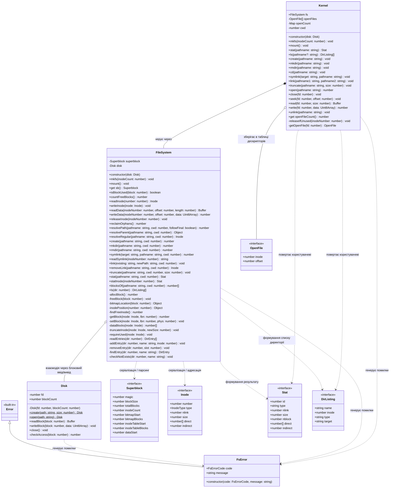

# Архітектура та діаграма класів файлової системи

У цьому документі наведено аналіз структури розробленої файлової системи (Лабораторна робота №5) та діаграму класів у форматі Mermaid.

---

## 1. Архітектурний аналіз

Архітектура побудована за принципом чіткого розділення відповідальності на три основні рівні:

1. **Рівень блокового носія (`Disk`)**:
   - Абстрагує файл віртуального диска `disk.img` як послідовність фізичних блоків фіксованого розміру (256 байтів).
   - Забезпечує суворо блоковий ввід/вивід (`readBlock`, `writeBlock`) із контролем меж диска.
   - Не містить знань про структуру самої файлової системи.

2. **Рівень драйвера файлової системи (`FileSystem`)**:
   - Реалізує внутрішню логіку дискових структур:
     - **Superblock**: читання та ініціалізація метаданих розміщення.
     - **Block Bitmap**: бітова карта зайнятості блоків, виділення (`allocBlock`) та звільнення (`freeBlock`).
     - **Inode Table**: збереження та завантаження дескрипторів файлів (тип, розмір, `nlink`, прямі та непрямі покажчики).
     - **Дерево директорій**: записи `(name, inode)` у блоках будь-якої директорії, явні `.` та `..`, повторне використання вільних слотів (`INACTIVE_INODE = -1`).
     - **Шляхові імена**: `resolvePath` / `resolveParent` з розкриттям символічних посилань (ліміт `MAX_SYMLINK_HOPS = 40`).
     - **Блокова адресація**: 6 прямих покажчиків (`direct`) + 1 непрямий покажчик (`indirect` на блок із 64 номерами).
     - **Sparse-файли**: підтримка нерозподілених нульових блоків без їх фізичного створення на диску.

3. **Рівень підсистеми ядра (`Kernel`)**:
   - Керує станом у пам'яті (in-memory kernel state):
     - Таблиця відкритих файлів (`openFiles`) та видача мінімального вільного цілочисельного дескриптора `fd`.
     - Незалежні покажчики позиції читання/запису (`offset`) для кожного відкритого `fd`.
     - Лічильники відкритих файлів (`openCount`) для реалізації семантики POSIX: відкладене фізичне видалення файлу після `unlink`, якщо він залишається відкритим у процесі.

---

## 2. Діаграма класів (Mermaid Class Diagram)

---

## 3. Взаємозв'язки та життєвий цикл операцій

- **Створення файлу (`Kernel.create`)**:
  `Kernel.create()` $\to$ `FileSystem.create()` $\to$ `resolveParent()` (батьківська директорія з урахуванням CWD) $\to$ пошук вільного слота в ній $\to$ пошук вільного `Inode` $\to$ запис `Inode` на диск із `nlink=1, size=0`.

- **Відкриття файлу (`Kernel.open`)**:
  `Kernel.open()` $\to$ `FileSystem.resolveRegular()` (пошук за шляхом з розкриттям symlink, лише звичайний файл) $\to$ виділення найменшого вільного числового `fd` в `Kernel.openFiles` $\to$ встановлення початкового `offset = 0` $\to$ збільшення лічильника в `Kernel.openCount`.

- **Читання та запис (`Kernel.read` / `Kernel.write`)**:
  `Kernel` транслює числовий `fd` у відповідний номер `inode` та поточний `offset`.
  `FileSystem.readData()` / `FileSystem.writeData()` обчислюють номери логічних блоків `lbn = Math.floor(pos / BLOCK_SIZE)` та зсув `pos % BLOCK_SIZE`, звертаючись до direct-масиву або indirect-блоку. Фізичний ввід/вивід делегується в `Disk.readBlock()` / `Disk.writeBlock()`.

- **Видалення (`Kernel.unlink`) та відкладене звільнення**:
  `Kernel.unlink()` видаляє запис із директорії через `FileSystem.removeLink()` та зменшує `nlink`. Якщо на момент видалення файл ще відкритий (`openCount > 0`), блоки та `Inode` залишаються цілими. Лише під час виклику `Kernel.close()`, коли лічильник відкриттів спадає до 0, викликається `FileSystem.releaseInode()` для остаточного звільнення блоків у bitmap.
